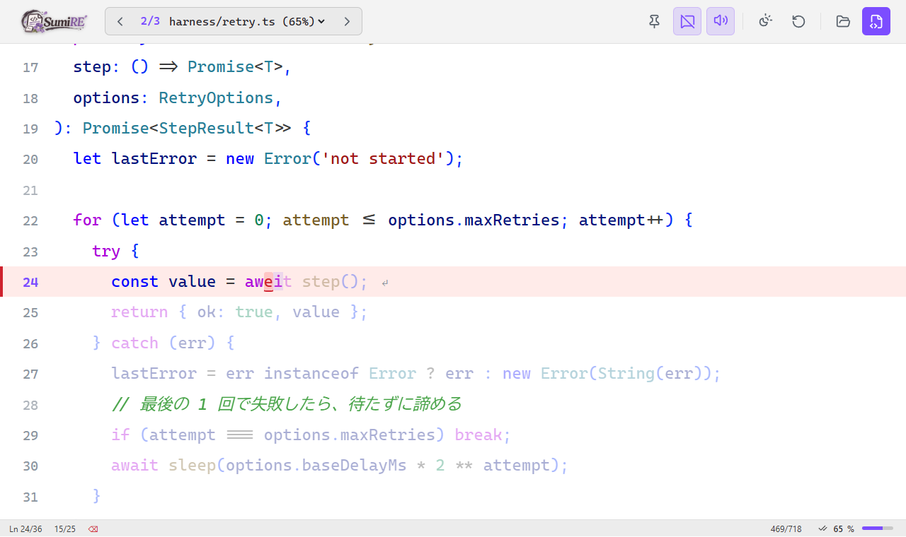
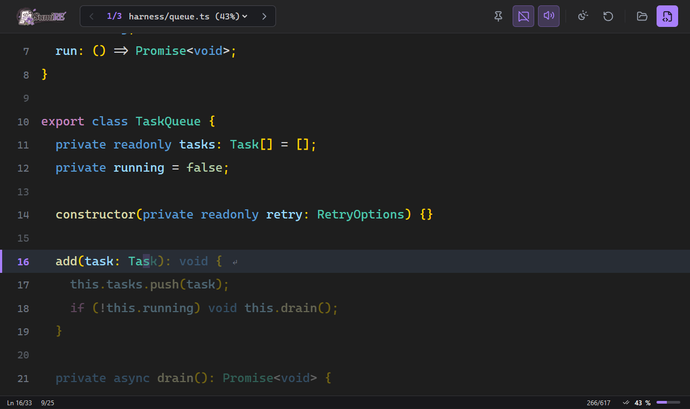

<p align="center">
  
</p>

<h3 align="center">AI が書いたコードを、上からなぞって、指で覚える。</h3>

<p align="center">
  自分のプロジェクトのスクリプトを、そのまま写経のお手本にするローカルのタイピングノート。<br>
  <b>インストールして、フォルダで <code>sumire</code> と打つだけ。</b>ファイルは読むだけで、書き換えません。
</p>

<p align="center">
  
</p>

---

## AI が書いたコード、読んだだけで終わっていませんか？

AI を使った開発では、動くコードが一瞬で手に入ります。そのぶん、自分の手で書く機会がなくなります。

- レビューして「分かった」つもりでも、何も見ずには書けない
- 写経しようとエディタに書き写すと、ファイルの行き来・インデント・括弧の自動補完がじゃまをする
- タイピング練習のサイトでは、自分のプロジェクトのコードは打てない

SumiRE（すみぃれ）は、**自分のフォルダのコードを、そのまま写経のお手本にします。**

1. **開く** — フォルダで `sumire` と打つ。中のスクリプトが、ノートのページになる
2. **なぞる** — 薄く表示されたコードの上に、そのまま打つ。インデント・空行・コメントは飛ばす
3. **めくる** — 最後まで打ったら Enter で次のファイルへ。途中のファイルに戻っても、続きから打てる

> 名前は、下書きの上から墨で清書する「墨入れ」と、花の「菫（すみれ）」から。

## 特長

- **視線を動かさない** — お手本と打つ場所が同じ。薄い文字の上に、そのまま色を乗せていく
- **打たなくていいものは飛ばす** — 行頭のインデント・空行・コメント行は、カーソルが自動で飛び越える（コメントは打つようにも切り替えられる）
- **間違いが見える** — 打ち間違えた文字は、赤いまま残る。Backspace で消して打ち直す（タイプライター式）
- **手元だけで動く** — サーバーは自分のパソコンの中だけ。読み取り専用で、設定ファイルもいらない

<p align="center">
  
</p>

### HanaME と SumiRE

[HanaME（花見）](https://github.com/HarutarouKawamoto/haname) と対になるツールです。

| | HanaME（花見） | SumiRE（墨入れ / 菫） |
|---|---|---|
| 対象 | AI が書いた .md | AI が書いたスクリプト（.ts / .js / .py など） |
| やること | 読んで、質問して、**頭で**理解する | なぞって打って、**指で**覚える |
| 起動 | フォルダで `haname` | フォルダで `sumire` |

---

## はじめかた

### 必要なもの

- **Node.js 22.23.4 / 24.22.1 / 26.12.1 以降**
  （Node2Shell〔CVE-2026-111497〕の修正版。これより古い Node.js では起動しません）
- ブラウザ（Chrome・Edge・Firefox・Safari）

### インストール

```bash
git clone https://github.com/HarutarouKawamoto/sumire.git
cd sumire
npm install
npm link
```

`npm link` しておくと、どのフォルダでも `sumire` コマンドが使えます。
画面はビルド済みなので、インストールしたらすぐに使えます。

### 起動

なぞりたいフォルダで起動します。ブラウザが自動で開きます。

```bash
cd your-project
sumire
```

### まず試す

このリポジトリには、試し打ち用の小さなサンプル（`sample/`）が入っています。

```bash
cd sumire
sumire sample
```

---

## 使い方

### 打つ

| 操作 | 動き |
|---|---|
| そのまま打つ | カーソルの文字を上からなぞる。正しい文字には色がつく |
| 違う文字を打つ | 赤い文字として残る（カーソルは進む） |
| Backspace | 1 文字戻る。赤い文字を消して打ち直す |
| Enter | 行の最後まで正しく打てたら、次の行へ（赤い文字が残っているうちは進まない） |
| 行をクリック | その行から打ち始める |

- 行頭のインデントは打ちません。カーソルは、その行の最初の文字に着地します。
- 空行と、`//` `/* */` のコメント行は、自動で飛ばします（上部のボタンで、コメントも打つように切り替えられます）。
- 行末の空白は、はじめから取り除いてあります。

### めくる

| 操作 | 動き |
|---|---|
| Alt + ← / → | 前後のファイルへ（フォルダ → ファイルの順。フォルダをまたいで続く） |
| 上部のファイル名 | 一覧から選んで移動。各ファイルの進行度（%）が見える。打ち終えたファイルには ✓ |
| ファイルを最後まで打って Enter | 次のファイルへ |

下のステータスバーの右端が、開いているファイルの進行度（0〜100%）です。

### ボタン

ボタンは文字を使わず、アイコン（[Lucide](https://lucide.dev/)）だけです。

| アイコン | 動き |
|---|---|
| ピン | 打っている行を、常に画面のいちばん上に置く（ON / OFF） |
| 吹き出しに斜線 | コメント行を飛ばす / 打つ |
| スピーカー | 打鍵音の ON / OFF |
| 太陽と月 | 配色を切り替える（OS に合わせる → 夜 → 昼） |
| ↺ | 開いているファイルを、最初からやり直す |
| フォルダ / ファイル | ほかのフォルダ・ファイルを開く（画面へのドラッグ＆ドロップでも開ける） |

> 打った内容は保存しません。ブラウザを再読み込みすると、すべてのファイルが最初からになります。

---

## コマンド

| コマンド | できること |
|---|---|
| `sumire [フォルダ]` | そのフォルダのスクリプトをノートにして開く（省略時は今いるフォルダ） |
| `sumire src/main.ts` | 今いるフォルダをノートにして、そのファイルのページから始める |
| `sumire --version` | 版を表示する |

起動オプション: `--port <番号>`（初期値 4848。使用中なら次の番号を使う）/ `--no-open`（ブラウザを開かない）

終了するときは、起動したターミナルで Ctrl+C を押します。

---

## 詳しい仕組み

<details>
<summary>ページになるファイル</summary>

- 拡張子: `.ts` `.tsx` `.js` `.jsx` `.mjs` `.cjs` `.vue` `.svelte` `.py` `.rs` `.go` `.java` `.kt` `.c` `.h` `.cpp` `.hpp` `.cs` `.php` `.rb` `.swift` `.dart` `.lua` `.sh` `.ps1` `.sql` `.json` `.yaml` `.yml` `.toml` `.css` `.scss` `.html`
- 並び順: フォルダが先、ファイルが後。名前の数字は数として並べる（`2_` が `10_` より先。HanaME と同じ）
- ファイルの中身は、そのページを開いたときに初めて読み込みます（大きなフォルダでも、すぐに起動します）。

</details>

<details>
<summary>ページにならないファイル</summary>

写経しても意味のない、機械が作るファイルは表示しません。

- `.gitignore` の対象
- フォルダ: `node_modules`・`.git`・`dist`・`build`・`out`・`.next`・`.nuxt`・`.svelte-kit`・`.turbo`・`.cache`・`coverage`・`vendor`・`__pycache__`・`.venv`・`venv`・`target`
- ロックファイル: `package-lock.json`・`pnpm-lock.yaml`・`yarn.lock`・`bun.lock(b)`・`composer.lock`・`Cargo.lock`・`poetry.lock`
- `.min.js`・`.min.css`・`.map`
- 256KB を超えるファイル、中身が空のファイル

</details>

<details>
<summary>進行度の数え方</summary>

- 打つ対象（インデント・空行・飛ばしたコメント行を除いた文字）のうち、正しく打てた文字の割合です。
- コメント行を「打つ」に切り替えると、コメントも対象に入るため、割合が変わります。

</details>

---

## セキュリティ

- サーバーは `127.0.0.1` だけで待ち受け、外部からは接続できません。
- **読み取り専用です。** ファイルを書き換える機能はありません（GET 以外のリクエストは拒否します）。
- 読めるのは、起動したフォルダの中の、ページになるファイルだけです（`../` やシンボリックリンクでフォルダの外を指すものは拒否します）。
- DNS リバインディング（Host ヘッダーの確認）とクリックジャッキング（`X-Frame-Options`）を防ぎ、ページには CSP を設定しています。
- コードは文字として表示するだけで、実行しません。
- **HTTP2Shell（Node2Shell / CVE-2026-111497）** への対策:
  - 修正版より古い Node.js では起動しません。
  - `Content-Encoding` に `br`（Brotli）を含むリクエストは、本文を読まずに `415` で拒否します（大文字小文字・`gzip, br` のような複数指定も対象）。
  - サーバーは Brotli の展開（`zlib`）を使わず、WebSocket もありません。

---

## 開発者向け

```bash
npm run dev     # 画面だけを Vite で起動（サーバーなし。SumiRE 自身の src/ がページになる）
npm run build   # 画面をビルドして dist/ に出力（型チェック込み）
npm start       # sumire コマンドと同じ（node bin/sumire.js）
npm test        # サーバーのテスト（Node.js の node:test。追加の依存なし）
node scripts/capture-readme.mjs   # README のスクリーンショットを撮り直す（Edge を使う）
```

画面（`src/`）を変えたら、**コミットの前に `npm run build`** を実行して、`dist/` も一緒にコミットしてください。
利用者は `dist/` をそのまま使います（インストール時にビルドしないため）。

```
bin/sumire.js            CLI（引数・Node.js の版の確認・ブラウザを開く）
lib/server.js            ローカルサーバー（ファイル一覧・読み込み・画面の配信。読み取り専用）
src/main.ts              画面の操作・描画
src/core/parser.ts       行に分ける・インデント／空行／コメントの判定
src/core/session.ts      タイプライター式の入力状態
src/core/notebook.ts     ノート（ファイルの束）とページの読み込み
src/core/highlighter.ts  VS Code 風の色分け
src/audio/sound.ts       打鍵音（Web Audio API。音声ファイルなし）
dist/                    ビルド済みの画面（git に含める）
test/                    テスト（HTTP2Shell 対策など）
sample/                  試し打ち用のサンプル
scripts/capture-readme.mjs  README のスクリーンショットを撮る
docs/images/             README の画像
```

依存パッケージ: [ignore](https://github.com/kaelzhang/node-ignore)（.gitignore の判定）。
画面で使う [Lucide](https://lucide.dev/)（アイコン）は、`dist/` に組み込み済みです。

## ライセンス

MIT
